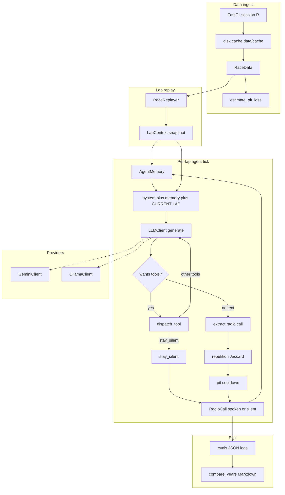
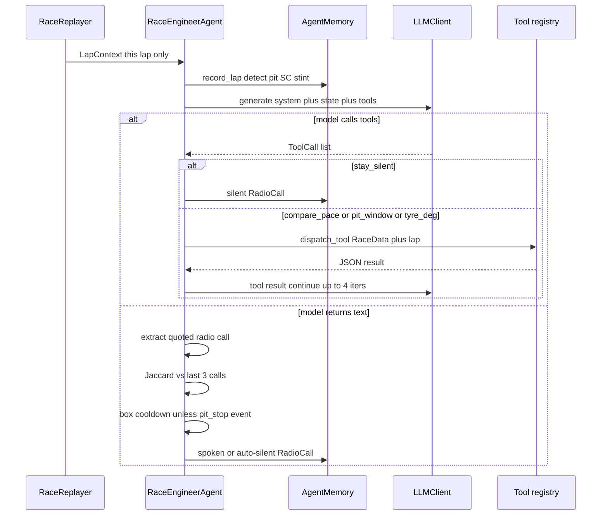
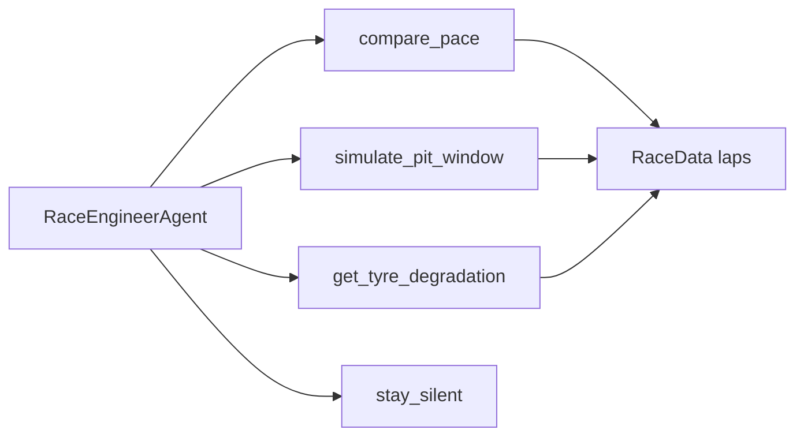

# F1 Race Engineer Agent

An agentic AI system that acts as a virtual Formula 1 race engineer, reasoning over real telemetry lap-by-lap and producing strategy calls in real time. The agent is given lap state as it would arrive on live timing data — it has no foreknowledge of subsequent laps — and decides whether to make a radio call, which tool to invoke, and what to say.

Built primarily on the 2024 Azerbaijan Grand Prix, with cross-year validation on 2023 and 2025.

---

## What this project is

A complete agentic system with five working parts:

1. **A FastF1-backed data pipeline** that loads any race, computes per-circuit pit-loss from actual stops, and exposes lap-by-lap structured state.
2. **Four tools** the agent can invoke: pace comparison, pit-window simulation, tyre degradation fitting, and an explicit "stay silent" action.
3. **A provider-agnostic agent loop** that runs against either Gemini 2.5 Flash (cloud) or Qwen 3 14B via Ollama (local) without code changes.
4. **Three layers of behavioural defence**: prompt rules, token-similarity repetition check, and a domain-specific pit-recommendation guardrail that uses race events to decide when a "box" call is plausible.
5. **A cross-year evaluation framework** that runs the same agent against three editions of the same race, persists structured logs, and auto-generates a Markdown comparison report.

This isn't a chatbot. It's a tool-using agent with measured pit-loss values, fitted degradation curves, and a documented validation methodology.

---


## Why this project

I'm targeting F1 strategy and machine-learning engineering roles. The closest publicly buildable analog to that work is an agent that processes live timing data, invokes physics-aware tools, and makes the kinds of calls a real race engineer makes. This project demonstrates: time-series analysis from real telemetry, regression-based modelling with appropriate model selection, tool-using LLM architecture, multi-provider abstraction, and the kind of defensive engineering that production strategy software requires.

---


## Headline result: cross-year pit-loss measurement

The strongest quantitative output of this project. Pit loss is measured directly from each race's actual stops using a baseline-subtraction method (`src/tools/pit_loss.py`), trimmed for outliers, and used by the strategy simulator instead of a hardcoded constant.


| Year | Race          | Measured pit loss | Source           |
| ---- | ------------- | ----------------- | ---------------- |
| 2023 | Azerbaijan GP | 21.33s            | 17 sampled stops |
| 2024 | Azerbaijan GP | 20.56s            | 17 sampled stops |
| 2025 | Azerbaijan GP | 19.53s            | 14 sampled stops |


**Spread: 1.80s.** Three years, same circuit, independent samples, no parameter tuning between years. The measurement converges within a tight band — consistent with the documented small reductions in F1 pit-lane speed regulations and stop quality improvements year-on-year. This is a directly measurable engineering result; it would have been wrong to hardcode it as a constant.

---


## Architecture

This is a **historical-replay agent**, not a live dashboard. FastF1 loads a past Grand Prix (race session only); `RaceReplayer` feeds one `LapContext` at a time with no future laps; the LLM may call tools; the loop emits a radio call or silence; JSON logs feed a Markdown comparison report.

Default target: Azerbaijan GP, driver `NOR`. The same unchanged agent is validated on 2023, 2024, and 2025.

The provider-agnostic `LLMClient` interface is the architectural keystone. The agent loop, memory, tools, and tests don't know which model is reasoning. Adding a new provider is one file.

### End-to-end flow




### Per-lap decision loop




### Tools the model can invoke




Safety nets after a spoken call: prompt rules; Jaccard token similarity ≥ 0.75 vs the last 3 calls; pit-recommendation cooldown of 5 laps unless a `pit_stop` event was recorded. Max 4 tool iterations per lap.

---


## Implemented vs remaining


| Layer                                                                                    | Status                                                               |
| ---------------------------------------------------------------------------------------- | -------------------------------------------------------------------- |
| FastF1 race load, measured pit loss, `LapContext`, `RaceReplayer`                        | Done (race session `"R"` only)                                       |
| Four tools: `compare_pace`, `simulate_pit_window`, `get_tyre_degradation`, `stay_silent` | Done                                                                 |
| Provider-agnostic loop + Gemini 2.5 Flash + Ollama                                       | Done                                                                 |
| Memory (last 5 laps / 5 calls, pinned pit/SC/stint events)                               | Done                                                                 |
| Three behavioural defences + radio-call extraction                                       | Done                                                                 |
| CLI runners + cross-year JSON logs + Markdown report                                     | Done (2023–2025 Baku, laps 10–35)                                    |
| Unit tests (~131 `test_*` functions)                                                     | Done                                                                 |
| Fuel-correction term in tyre degradation                                                 | Remaining (8-lap window is the workaround)                           |
| Streamlit dashboard                                                                      | Remaining (listed in `requirements.txt`, no app)                     |
| Live timing                                                                              | Remaining (`LapContext` is shaped for it; replay is historical only) |
| Anomaly-detection tool                                                                   | Remaining (not in this repo)                                         |
| Practice / qualifying sessions                                                           | Remaining                                                            |
| Predictive strategy (SC probability, Monte Carlo)                                        | Remaining                                                            |
| Baku 2026 re-validation                                                                  | Remaining (CLI already accepts the year)                             |


---


## Key engineering decisions

This section is the project's substance. Each item is a problem I encountered, a decision I made, and a tradeoff I accepted.

### 1. Measured pit loss instead of a static constant

The strategy simulator needs to know how much time a stop costs. The lazy approach is a constant. The right approach is to measure it from this race's actual stops: for each stop, compute `(in_lap_time + out_lap_time) − 2 × baseline_stint_pace`. Average across drivers, trim outliers (botched stops, safety-car stops), expose the sample count and provenance so the agent knows whether it's seeing measured data or a fallback constant.

### 2. Undercut/overcut math — a bug found through real-data validation

The initial pit-window simulator produced ~19-second swings between scenarios on real Baku data, with every gap favouring the same direction. That couldn't be right — real F1 undercut gains are sub-second to a few seconds at most. Diagnosis: the model treated `pit_loss` as a cost paid by only one driver in each scenario. In reality, both drivers eventually pit, so `pit_loss` cancels in the final gap. The corrected math: the swing between undercut and overcut is `2 × fresh_tyre_advantage_per_lap`, typically 2-3 seconds. The fix was twelve lines of math; the discovery was the validation process.

### 3. Tyre degradation fitter — the fuel-burn confound

The first version regressed lap time on tyre age across the full stint. On 2024 Baku data it produced slopes of −0.96 s/lap — claiming Norris's car got nearly a second a lap faster as tyres aged. Physically impossible. Diagnosis: F1 lap times are driven by two competing effects, tyre degradation (~+0.05 s/lap) and fuel burn as the car gets lighter (~−0.07 s/lap). Over a long stint, fuel burn dominates and masks the degradation signal. The mitigation is to fit only the most recent N laps (default 8), over which fuel mass is approximately constant. The proper fix would be an explicit fuel-correction term using known burn rates per regulation generation — documented as a limitation, not implemented in this version.

Both linear and quadratic models are fit; the better one is selected via adjusted R² (which penalises extra parameters and prevents the quadratic from overfitting small samples). The output exposes both R² values for transparency.

### 4. Three layers of behavioural defence

Local LLMs can fail in characteristic ways under structured prompts. We encountered:

- Repeating the same radio call lap after lap ("Box this lap" 16 times in a row on qwen3:8b)
- Recommending pit stops against three different rivals on three consecutive laps (a single car can only pit once)
- Producing valid-looking but unactionable reasoning paragraphs alongside the radio call

The defences:

- **Prompt rules**: explicit examples of bad output and a "default to silence" instruction.
- **Token-similarity repetition check**: Jaccard similarity ≥ 0.75 against recent calls converts the duplicate to a silent action with a logged reason.
- **Pit-recommendation guardrail**: any "box this lap" recommendation is suppressed if a previous one was made within the last 5 laps and no `pit_stop` event has been recorded in memory since.

Each defence has its own test file and works on top of whatever LLM is plugged in. With qwen3:14b + all three layers, the agent produces 5 well-spaced radio calls per race instead of 26 repetitive ones.

### 5. Provider-agnostic design, validated end-to-end on both providers

The `LLMClient` abstraction defines `ToolCall`, `ToolResult`, `LLMResponse`, and a `generate()` method. The agent loop imports only from this interface. Gemini-specific translation lives in `gemini_client.py`; Ollama-specific translation in `ollama_client.py`. Both clients have their own unit tests covering message translation and tool-call parsing.

This isn't theoretical — both providers run the same agent against the same Baku data. Gemini produces sharper, more varied calls; Ollama runs without API quotas, billing, or network dependency. Production deployment could swap to either based on operational requirements.

### 6. Honest evaluation, not curated screenshots

The cross-year framework (`src/run_cross_year.py` + `src/compare_years.py`) runs the unchanged agent against three Azerbaijan GP editions and produces a Markdown report covering: per-year summary table, tool usage frequencies, pit-loss drift analysis, strategic-moment detection, and representative radio calls. The report is regenerated end-to-end from JSON logs whenever new race data is added. When the 2026 Azerbaijan GP completes in September, adding it is two commands.

---


## Sample radio calls


### 2024 Baku, laps 21–25 (Gemini 2.5 Flash)

The strategic phase during a McLaren battle with Williams and Mercedes:

```
L21  📻 SAI closing, 1.1s quicker over the last three. Watch the gap.       (compare_pace)
L22  📻 SAI now just 0.1s. He's 0.9s quicker over the last three. Defend.   (compare_pace)
L23  📻 VER closing, he's 0.7s quicker over the last three. Defend.         (compare_pace)
L24  📻 VER gap now 0.7. He's still quicker, but gap stable. Keep pushing.  (compare_pace)
L25  📻 VER closing, gap 0.45. He's two tenths quicker over the last three. (compare_pace)
```

Each call is grounded in tool output (specific seconds-per-lap numbers from `compare_pace`), uses real F1 terminology ("defend", "keep pushing", "watch the gap"), and the agent's framing shifts as the rival changes (SAI on L21–22, then VER once Sainz passes). Memory propagation is what enables that shift.

### 2024 Baku, lap 29 (Qwen 3 14B, local)

```
L29  📻 Overcut favoured. Staying out projects +0.6s gap to VER.   (simulate_pit_window)
```

The model invoked `simulate_pit_window`, received a projection of +0.6s, and produced a strategic *counter*-call — not "pit now" but explicitly the opposite. This is the strongest demonstration of the agent reasoning about a strategy choice rather than reacting to a gap.

### 2023 Baku, laps 22–34 (Qwen 3 14B, local)

A real engineer's arc across three radio moments separated by quiet laps:

```
L22  📻 Tyre degradation increasing. Box next lap if gap to HUL closes below 1.0.   (get_tyre_degradation)
L27  📻 Box this lap. Undercut window on HUL, gap closing.                          (compare_pace)
L33  📻 Gap to HUL stable at 0.59. Tyres holding, no immediate pit needed.
L34  📻 Gap to HUL widening to 1.0. Tyres holding, no immediate pit needed.
```

L22 is a conditional call grounded in the tyre fitter's output. L27 escalates as the conditions are met. L33 and L34 reverse the prior advice as the gap dynamics change — real engineering judgement, not boilerplate "box this lap" repetition.

---


## Known limitations

Honest engineering means listing the things that aren't quite right yet:

- **Tyre degradation fitter does not include an explicit fuel-correction term.** Mitigated by windowing to recent laps; production-grade would correct directly.
- **Smaller local LLMs (qwen3:8b, qwen3:14b) drop into repetitive patterns under structured prompts.** Mitigated by the three safety nets, but Gemini produces noticeably more varied output.
- **The agent is reactive, not predictive.** It reasons over what has happened up to the current lap. It does not forecast safety-car probability, model competitor strategies multiple laps ahead, or run Monte Carlo simulations. A production race-strategy system would.
- **Only the race session is loaded.** Free practice and qualifying data would improve pit-loss estimates and tyre-degradation priors. Not in scope for v1.

---


## What's in the repo

```
race-engineer-agent/
├── src/
│   ├── agent/
│   │   ├── llm_client.py          # provider-agnostic interface
│   │   ├── gemini_client.py       # Gemini 2.5 Flash implementation
│   │   ├── ollama_client.py       # Ollama (local model) implementation
│   │   ├── prompts.py             # system prompt with safety rules
│   │   └── race_engineer.py       # the agent loop
│   ├── data/
│   │   ├── race_data.py           # FastF1 wrapper + measured pit loss
│   │   ├── lap_context.py         # structured per-lap snapshot
│   │   └── replayer.py            # lap-by-lap iterator
│   ├── memory/
│   │   └── agent_memory.py        # rolling window + pinned events
│   ├── tools/
│   │   ├── compare_pace.py        # pace delta + sector breakdown + trend
│   │   ├── simulate_pit_window.py # undercut / overcut simulator
│   │   ├── tyre_degradation.py    # linear/quadratic deg fitter
│   │   ├── pit_loss.py            # measured pit loss from real stops
│   │   ├── stay_silent.py         # explicit no-call action
│   │   └── registry.py            # tool spec + dispatcher
│   ├── run_agent.py               # single-race runner
│   ├── run_cross_year.py          # multi-year batch runner
│   └── compare_years.py           # Markdown report generator
├── tests/                         # 129 tests, all passing
└── evals/
    ├── cross_year/                # JSON logs from batch runs
    └── reports/                   # generated Markdown reports
```

---


## Running locally


### Requirements

- Python 3.11+
- ~500MB disk for the FastF1 cache after first race load
- For local LLM: [Ollama](https://ollama.com) + `ollama pull qwen3:14b` (~9GB)
- For cloud LLM: a free [Google AI Studio](https://aistudio.google.com) API key


### Setup

```bash
python -m venv .venv
source .venv/bin/activate
pip install -r requirements.txt
cp .env.example .env             # edit to add API keys if using Gemini
```


### Verify

```bash
python -m pytest tests/ -v       # ~131 tests should pass
```


### Run

```bash
# Single race, local model
python src/run_agent.py --provider ollama --laps 15-25

# Single race, Gemini (free tier — needs --delay 15)
python src/run_agent.py --provider gemini --laps 15-25 --delay 15

# Cross-year batch
python src/run_cross_year.py --provider ollama --years 2023 2024 2025

# Generate Markdown report from logs
python src/compare_years.py
```

---


## Test coverage

~131 tests, all passing. Notable areas:

- 9 tests for pace comparison (sector deltas, pit-lap filtering, trend detection)
- 10 tests for pit-window simulation (undercut/overcut symmetry, pit-loss cancellation, emergence gaps)
- 23 tests for tyre degradation (linear/quadratic selection, windowing, fuel-burn isolation, plausibility caps)
- 12 tests for the repetition safety net
- 13 tests for the pit-recommendation guardrail
- 9 tests for the Gemini client translation
- 10 tests for the Ollama client translation
- 9 tests for memory layer (event auto-detection, window capping)
- 7 tests for the agent loop with mocked LLM (tool dispatch, iteration cap, silent fallback)
- 15 tests for the cross-year report builder

Tests run in ~3 seconds end-to-end. No external dependencies needed — every test that touches the data layer uses synthetic stints constructed with known degradation rates.

---


## Tech stack

**Used in** `src/`

- **Python 3.11+**, type-hinted dataclasses throughout
- **FastF1** for race data (laps, weather, race-control messages; telemetry off)
- **NumPy / pandas** for data wrangling
- **scikit-learn** (`LinearRegression` / `PolynomialFeatures`) for tyre-degradation OLS and pace-trend slope
- **google-genai** SDK for Gemini 2.5 Flash
- **ollama** SDK for local Qwen (`.env` default is `qwen3:8b`; this README often cites `qwen3:14b` for stronger local runs)
- **python-dotenv** for config
- **pytest** for the test suite

There is no UI, FastAPI, or database. Persistence is JSON under `evals/`.

**Listed in** `requirements.txt` **but unused in** `src/` (reserved for v2 or leftover from setup): `streamlit`, `matplotlib`, `pydantic`, `scipy`.

---


## What's next

In rough priority order (see **Implemented vs remaining** above):

1. **Re-validate on Baku 2026** when FastF1 publishes the data after the September 23–26 weekend. The runner already supports it — adding the year is one CLI argument.
2. **Explicit fuel-correction term** in the tyre degradation fitter (mentioned above).
3. **Anomaly detection tool** wrapping a prior F1 sensor-anomaly project ([github.com/neomond/f1-sensor-anomaly-detection](https://github.com/neomond/f1-sensor-anomaly-detection)) so the agent can flag genuine sensor problems in addition to strategic moments.
4. **Streamlit dashboard** for live race replay with the agent's calls overlaid.
5. **Live timing integration** — currently the agent runs on historical data; the lap-context interface is shaped identically to what live timing produces.
6. **Cleanup** — drop unused requirements, align the Ollama default (8b vs 14b). Extra providers (Claude, Mistral) are mentioned in comments but not implemented.

---


## Contact

Nazrin Atayeva
[linkedin.com/in/nazrin-atayeva](https://linkedin.com/in/nazrin-atayeva) · [github.com/neomond](https://github.com/neomond)