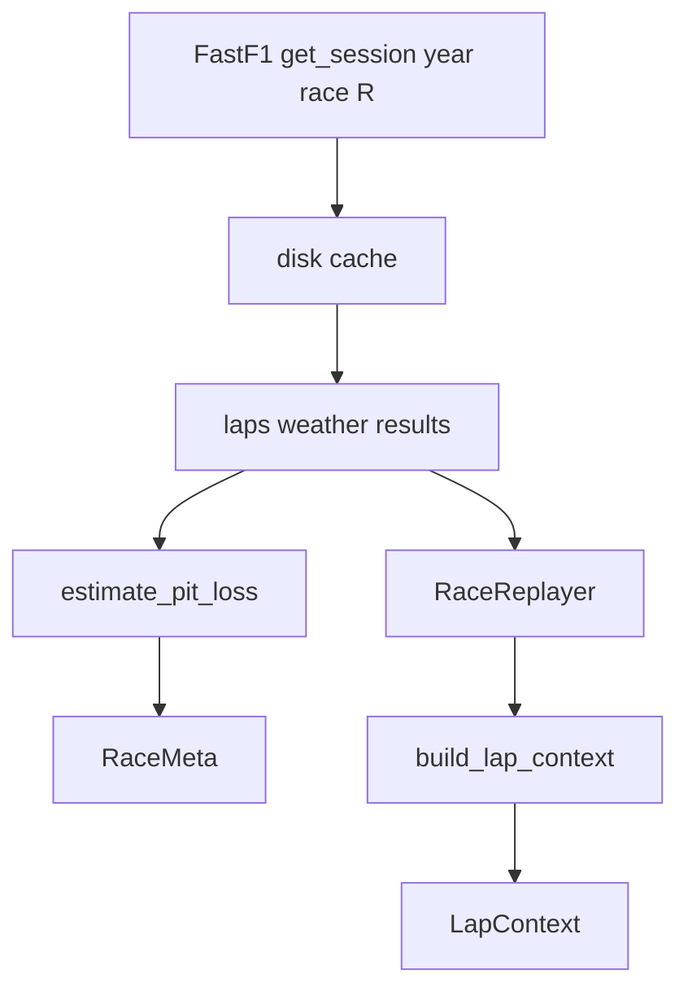

# Data

FastF1 load + lap-by-lap snapshots. Tools and the agent never import FastF1; they go through `RaceData`.

Only the **race** session (`"R"`) is loaded. Telemetry is off. Weather and race-control messages are on. The cache lives at `data/cache/` at the repo root.

## Files

| File | Role |
|---|---|
| [`race_data.py`](race_data.py) | `RaceData(year, race_name)` — session, accessors, measured pit loss |
| [`lap_context.py`](lap_context.py) | `LapContext` + `build_lap_context()` — facts only, no recommendations |
| [`replayer.py`](replayer.py) | `RaceReplayer` — yields one context per lap in order |

## Load and replay

`RaceData.__init__` lazy-imports `estimate_pit_loss` from `src.tools` so FastF1 wrapping and pit math stay separate.

## What a lap snapshot contains

`LapContext` is the target driver's view of **this** lap:

- position, lap time, last 3 times
- compound, tyre age, stint, in-pit
- gap ahead / behind
- track temp, air temp, rain
- track status (`green`, `yellow`, `safety_car`, `vsc`, …)

If FastF1 has no row for that driver/lap, `build_lap_context` returns `None` and the replayer skips it.

## Accessors used by tools

- `laps_up_to` / `current_stint_laps` — pace and tyre fits
- `all_drivers_at` / `lap_at` — gaps and single-lap rows
- `weather_at` — nearest weather sample to lap start
- `meta.pit_loss_seconds` — fed into the pit-window simulator
