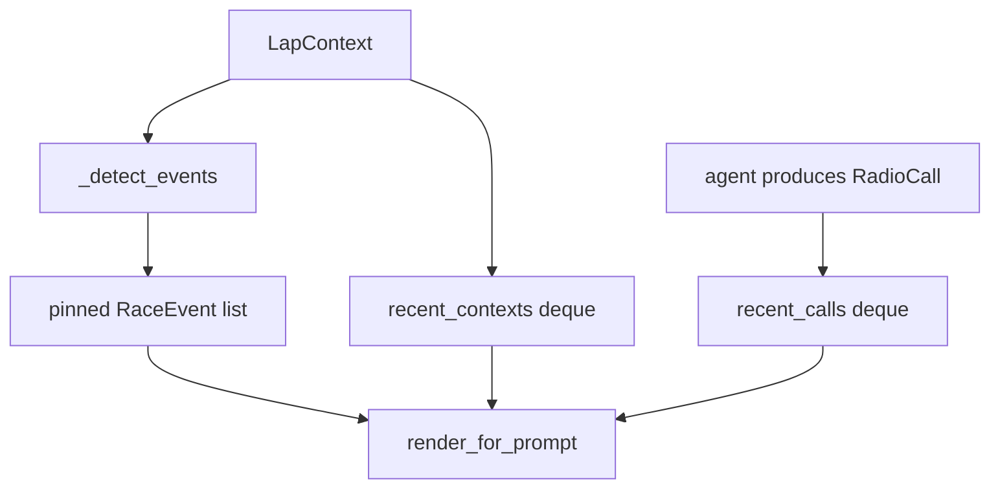

# Memory

Structured state for one race, not RAG. Short-term rolling windows plus a pinned event log. Rendered as text into the agent prompt each lap.

## Files

| File | Role |
|---|---|
| [`agent_memory.py`](agent_memory.py) | `AgentMemory`, `RadioCall`, `RaceEvent` |

Windows (tuned for ~50-lap races): last **5** `LapContext`s, last **5** `RadioCall`s. Events are unbounded and kept for the whole run.

## How it updates

`record_lap` runs before the LLM. `record_call` runs after the decision (spoken, `stay_silent`, or a guardrail conversion).

## Auto-detected events

Compared to the previous lap:

| Change | `event_type` |
|---|---|
| `stint_number` changes | `pit_stop` |
| status → SC / VSC | `safety_car_start` / `vsc_start` |
| SC / VSC → green | `safety_car_end` / `vsc_end` |

The pit-recommendation guardrail in the agent looks at these `pit_stop` events: a new “box this lap” is allowed only if a stop was recorded since the last box call (or the 5-lap cooldown has expired).

## Prompt block

`render_for_prompt()` emits three sections (newest last):

1. `RECENT EVENTS` — last 5 pinned events
2. `RECENT RADIO CALLS (avoid repeating)` — spoken line or silent reason
3. `LAP TREND` — position, tyre, lap time, gaps

Empty memory renders as `(no prior context)`.

JSON logs from the runners store each `RadioCall` and the full `events` list, not only the rolling deques.
