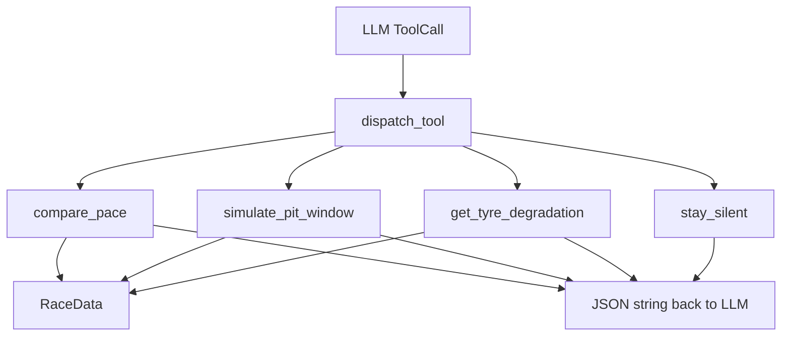

# Tools

Functions the LLM can invoke, plus pit-loss measurement used at race load. The agent never imports these modules by name; it goes through [`registry.py`](registry.py).

`pit_loss.py` is **not** an LLM tool. `RaceData` calls `estimate_pit_loss` once when the session loads.

## Files

| File | LLM name | Role |
|---|---|---|
| [`compare_pace.py`](compare_pace.py) | `compare_pace` | Pace delta, sectors, OLS trend (sklearn `LinearRegression`) |
| [`simulate_pit_window.py`](simulate_pit_window.py) | `simulate_pit_window` | 1-lap undercut vs overcut |
| [`tyre_degradation.py`](tyre_degradation.py) | `get_tyre_degradation` | Linear vs quadratic OLS, pick by adjusted R² |
| [`stay_silent.py`](stay_silent.py) | `stay_silent` | Explicit no-call; ends the lap |
| [`pit_loss.py`](pit_loss.py) | — | Measured stop cost from real in/out laps |
| [`registry.py`](registry.py) | — | `ToolSpec` list + `dispatch_tool` |

## Dispatch

Unknown names and handler exceptions become `{"error": ...}` JSON. The agent loop does not crash.

`stay_silent` is special: the agent treats it as a terminal action and does not wait for a spoken line.

## Math notes

**Pace trend** — `LinearRegression` of (driver A − driver B) lap time vs lap number. Slope classifies closing / stable / losing (`±0.05 s/lap`).

**Tyre degradation** — sklearn OLS on the last 8 clean laps: linear and (if ≥ 6 laps) quadratic via `PolynomialFeatures`. Winner needs adjusted R² at least 0.02 better than linear. Slopes outside `±2.0 s/lap` are capped. Windowing is the fuel-burn workaround; there is no explicit fuel term.

**Pit window** — both drivers eventually pit, so `pit_loss` cancels. The swing is `2 × fresh_tyre_advantage` (default 1.2 s/lap). Also reports the emergence gap after the stop.

**Pit loss** — `(in_lap + out_lap) − 2 × stint baseline`, averaged across drivers, outliers trimmed. Fewer than 3 clean samples → circuit fallback from `RaceData`.
